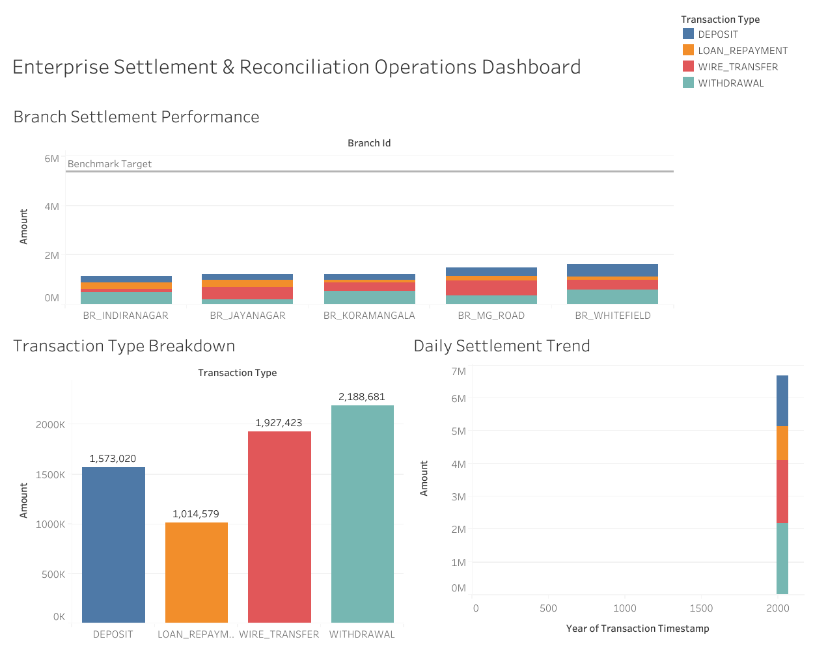

# Enterprise Automated Batch Fulfillment & Reconciliation Pipeline

An end-to-end operational analytics pipeline designed to process daily financial batch transactions across regional branch networks, track fulfillment variances against aggregate baseline benchmarks, and deliver cross-filtered executive visibility.

🔗 **[View Interactive Tableau Public Dashboard](https://public.tableau.com/app/profile/diya.damayanthi.k.s/viz/EnterpriseSettlementReconciliationOperationsDashboard/Dashboard1)**

---

## Dashboard Preview



---

## Business Objective & Problem Statement
High-volume retail banking batch pipelines require daily reconciliation between branch-level transaction inflows (deposits, wire transfers, loan repayments) and operational settlement thresholds. This project establishes an automated monitoring mechanism to identify anomalous branch variance, measure transaction type composition, and track intraday settlement velocity.

---

## Technical Architecture & Tools

* **Data Ingestion & Automation (`src/`, `scripts/`):** Python (Pandas, SQLite/BigQuery) for automated batch ingestion, schema validation, and anomaly quarantine; Linux Bash shell scripts for scheduled pipeline orchestration.
* **Analytical SQL Layer (`sql/`):** SQL queries utilizing Common Table Expressions (CTEs) and Window Functions (`SUM() OVER`, `DENSE_RANK`) to compute plan-vs-actual variance and branch settlement velocity.
* **BI & Visualization:** Tableau Public (Web Authoring) featuring Fixed Level of Detail (LOD) expressions and global cross-filtering actions.
* **Data Layer:** `bi_fact_transactions.csv` (Batch transaction ledger with timestamps, status, amount, and branch dimensions).
---

## Key Metrics & Analytical Features
* **Branch Settlement Performance:** Compares total volume across 5 regional branches against an enterprise baseline benchmark using a Fixed LOD target.
* **Transaction Mix Breakdown:** Real-time visibility into the distribution of Deposits, Withdrawals, Wire Transfers, and Loan Repayments.
* **Intraday Settlement Velocity:** Time-series tracking of batch processing across intraday execution windows.
* **Dynamic Cross-Filtering:** Interactive drill-down filtering across branches and categories across the entire view.

---

## Calculations & Logic
* **Branch Baseline Benchmark (LOD Expression):**
  ```tableau
  { FIXED : AVG({ FIXED [Branch Id] : SUM([Amount]) }) }

---

## Repository Structure

├── scripts/                 # Linux Bash automation & batch execution scripts
├── sql/                     # Analytical SQL queries (CTEs, Window Functions, reconciliation checks)
├── src/                     # Python ETL validation, anomaly quarantine & reporting scripts
├── bi_fact_transactions.csv # Processed batch transaction dataset for BI layer
└── dashboard_preview.png    # Executive dashboard snapshot
